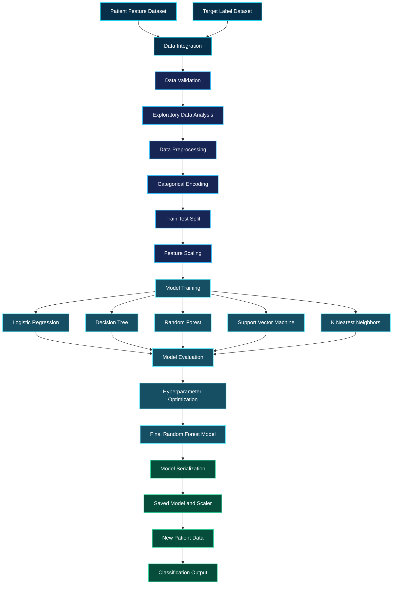

<div align="center">


<a href="https://git.io/typing-svg">

</a>

<br/>


<br/><br/>

<a href="https://github.com/govardhan-goud123/Heart_disease_prediction">

</a>
<a href="https://github.com/govardhan-goud123/Heart_disease_prediction">

</a>
<a href="https://github.com/govardhan-goud123/Heart_disease_prediction">

</a>

<br/><br/>

**An end-to-end machine learning project that analyzes patient data, evaluates classification algorithms, and builds a reusable heart disease prediction model.**

</div>

---

# 01. Project Overview

## Intelligence Begins With Data

Heart disease prediction is a healthcare machine learning application that explores how medical attributes can be used to identify patterns associated with heart disease.

This project transforms structured patient data into a machine learning classification pipeline. It combines data exploration, preprocessing, feature transformation, model development, hyperparameter optimization, and performance evaluation into one reproducible workflow.

The primary objective is to train a model that classifies patient records into two categories based on the target labels available in the dataset.

Rather than relying on a single algorithm, the project investigates multiple classification techniques and evaluates their performance using standard machine learning metrics.

The final workflow includes a trained Random Forest model and a saved feature scaler for subsequent predictions.

The project demonstrates how raw data can be converted into a trained model through a systematic data science process.

## Project Mission

Build a structured, reproducible, and technically documented machine learning system that demonstrates the complete journey from raw patient data to model-based classification.

The project focuses on five major objectives.

**Data intelligence**

Understand the structure of patient records, identify feature types, examine statistical distributions, and investigate relationships between variables.

**Feature engineering**

Prepare numerical and categorical features so they can be processed by machine learning algorithms.

**Algorithm experimentation**

Evaluate multiple classification algorithms and compare their predictive performance.

**Model optimization**

Use cross-validation and hyperparameter tuning to investigate better model configurations.

**Reusable prediction**

Save the final model and scaler so the trained system can be loaded for future inference.

---

# 02. System Architecture

## From Raw Data to Machine Learning Intelligence

The architecture follows a sequential data processing pipeline.



The flowchart represents the intended project workflow. It illustrates how the datasets are combined, how the data moves through preprocessing, how algorithms are evaluated, and how the final model can be used for predictions.

---

# 03. Machine Learning Workflow

## Stage One — Data Acquisition and Integration

The project uses two separate data files.

The feature dataset contains patient attributes, while the label dataset contains the target classification.

The datasets are joined using the patient identifier.

This creates a unified dataset in which each patient record is associated with its corresponding target label.

The initial data inspection examines the number of records, column names, data types, missing values, and duplicate records.

These checks help identify structural problems before model development begins.

## Stage Two — Exploratory Data Analysis

Exploratory Data Analysis provides an understanding of the underlying dataset.

The analysis investigates numerical distributions, categorical feature frequencies, possible outliers, and relationships between variables.

Histograms help reveal the distribution of numerical attributes.

Boxplots help identify unusually low or high observations.

Correlation heatmaps provide an overview of linear relationships between numerical features.

These visualizations support informed preprocessing decisions and help explain the characteristics of the dataset.

## Stage Three — Data Preparation

Machine learning algorithms require data in a suitable numerical format.

Categorical variables are transformed into numerical representations using encoding techniques.

Unnecessary identifier columns are excluded from the predictive feature set.

The target variable is separated from the input features.

The dataset is then divided into training and testing subsets.

The training data is used to develop the models, while the testing data is reserved for evaluating their performance.

Feature scaling is applied using StandardScaler where required by the modeling workflow.

The scaler is fitted on training data and subsequently used to transform the test data.

This approach prevents information from the test set from influencing the scaling parameters.

## Stage Four — Algorithm Development

Five classification algorithms are investigated.

Logistic Regression establishes a linear classification baseline.

Decision Tree learns a sequence of decision rules.

Random Forest combines predictions from multiple decision trees.

Support Vector Machine searches for a decision boundary that separates the classes.

K-Nearest Neighbors classifies records using the characteristics of nearby training observations.

Evaluating different algorithms provides a more complete view of the modeling problem than relying on one classifier alone.

## Stage Five — Optimization and Evaluation

Hyperparameter optimization investigates model configurations that may improve performance.

GridSearchCV evaluates candidate parameter combinations using cross-validation.

The final model is assessed using accuracy, precision, recall, F1-score, and confusion matrix analysis.

These metrics describe different aspects of classification performance.

The final Random Forest model and its scaler are saved for reuse.

---

# 04. Technology Stack

<div align="center">


<br/><br/>


</div>

| Technology       | Role in the Project                                   |
| ---------------- | ----------------------------------------------------- |
| Python           | Core programming language                             |
| Jupyter Notebook | Interactive development and experimentation           |
| Pandas           | Data loading, integration, and manipulation           |
| NumPy            | Numerical operations                                  |
| Matplotlib       | Statistical charts and visual analysis                |
| Seaborn          | Data visualization and correlation analysis           |
| Scikit-learn     | Preprocessing, model training, tuning, and evaluation |
| Joblib           | Model and scaler serialization                        |
| Git              | Version control                                       |
| GitHub           | Project hosting and documentation                     |

---

# 05. Dataset Intelligence

## Understanding the Input Space

The dataset contains 180 patient records according to the project analysis.

The feature and label files are integrated using the patient identifier.

The target variable is `heart_disease_present`.

| Dataset Property     | Description             |
| -------------------- | ----------------------- |
| Observation count    | 180 patient records     |
| Problem type         | Binary classification   |
| Target variable      | `heart_disease_present` |
| Target classes       | 0 and 1                 |
| Feature file         | `values.xls`            |
| Label file           | `labels.xls`            |
| Data integration key | `patient_id`            |

### Feature Categories

The dataset includes medical measurements and categorical attributes.

Examples of numerical features include age, resting blood pressure, serum cholesterol, maximum heart rate, and Oldpeak.

Examples of categorical features include chest pain type, resting ECG results, exercise-induced angina, and thalassemia-related categories.

The combination of different feature types makes preprocessing an important part of the machine learning pipeline.

### Target Interpretation

The model predicts one of the two classes defined by the dataset.

Class `0` represents the absence of the positive target label.

Class `1` represents the presence of the positive target label.

These are dataset classifications rather than confirmed clinical diagnoses.

---

# 06. Model Laboratory

## Comparing Classification Strategies

Each algorithm approaches classification differently.

### Logistic Regression

Logistic Regression provides a baseline for binary classification. It estimates the relationship between the input features and the probability of belonging to a particular class.

It is useful for establishing a reference point before evaluating more complex models.

### Decision Tree

Decision Tree creates a series of feature-based rules.

Its structure can be useful for understanding how different attributes contribute to individual classification decisions. However, a single tree can be sensitive to changes in training data.

### Random Forest

Random Forest combines predictions from multiple decision trees.

The ensemble approach can capture nonlinear relationships and interactions between features.

The project selects a tuned Random Forest model as its final classifier.

### Support Vector Machine

Support Vector Machine identifies a decision boundary between classes.

Feature scaling is particularly important for this algorithm because the magnitude of the input features can influence its behavior.

### K-Nearest Neighbors

K-Nearest Neighbors classifies observations based on nearby training examples.

Its predictions depend on the distance metric, the selected number of neighbors, and the representation of the input features.

---

# 07. Model Performance Dashboard

## Evaluation Metrics

<div align="center">


</div>

The values above represent the reported test-set results for the final model.

| Metric                         | Reported Result | Interpretation                                                                   |
| ------------------------------ | --------------: | -------------------------------------------------------------------------------- |
| Accuracy                       |          88.89% | Overall proportion of correct classifications                                    |
| Precision                      |          80.00% | Proportion of predicted positive cases that are positive according to the labels |
| Recall                         |         100.00% | Proportion of actual positive cases identified in the test set                   |
| F1-score                       |          88.89% | Harmonic mean of precision and recall                                            |
| Cross-validation mean F1-score |          0.7786 | Mean F1-score reported for the cross-validation procedure                        |

### Accuracy Analysis

The reported accuracy of 88.89% indicates that the model correctly classified approximately 88.89% of observations in the test set.

Accuracy provides a general measure of performance, but it does not describe every type of classification error.

### Precision Analysis

Precision measures how many observations predicted as positive were actually positive according to the dataset labels.

The reported precision is 80%.

### Recall Analysis

Recall measures the proportion of actual positive observations that the model identifies.

The reported recall is 100% for the evaluated test split.

This result does not guarantee that the model will identify every positive case in future datasets.

### F1-Score Analysis

F1-score combines precision and recall into a single metric.

It is particularly useful when both types of performance matter and the class distribution may be imbalanced.

### Cross-Validation Analysis

The reported cross-validation mean F1-score is 0.7786.

Comparing cross-validation performance with test-set performance helps highlight the importance of assessing model stability rather than relying on one test result.

The dataset is small, so the reported metrics should be interpreted cautiously.

---

# 08. Hyperparameter Optimization

## Searching for Better Model Configurations

Hyperparameter tuning evaluates different model settings to determine which configuration performs well under the selected evaluation procedure.

The project uses GridSearchCV for Logistic Regression and Random Forest.

The Logistic Regression search investigates the regularization parameter `C`.

The Random Forest search investigates settings including the number of trees, maximum tree depth, and minimum samples required for a split.

Five-fold cross-validation is used in the Random Forest search, with F1-score as the optimization metric.

The purpose of optimization is to improve generalization while controlling the risk of overfitting.

A high score on a small test set does not necessarily indicate that a model will perform equally well on unseen patient populations.

---

# 09. Saved Model Architecture

## Model Persistence and Reusability

The final Random Forest model is serialized to disk using Joblib.

The associated StandardScaler is saved separately.

This allows the model to be loaded again without repeating the training process.

```python
import joblib

joblib.dump(
    final_model,
    "heart_disease_random_forest.pkl"
)

joblib.dump(
    scaler,
    "heart_disease_scaler.pkl"
)
```

### Inference Pipeline


The inference diagram represents the intended prediction process. The actual implementation must reproduce the same feature ordering, categorical encoding, and preprocessing used during training.

---

# 10. Repository Structure

```text
Heart_disease_prediction/
|
|-- HeartDieseasePred (1).ipynb
|
|-- README.md
|
|-- description.docx
|
|-- values.xls
|
|-- labels.xls
|
|-- heart_disease_random_forest.pkl
|
|-- heart_disease_scaler.pkl
|
|-- assets/
    |
    |-- architecture.png
    |-- model_comparison.png
    |-- confusion_matrix.png
    |-- feature_importance.png
```

The `assets` directory is a proposed organization for future visualizations. The image files shown in this example must be created and uploaded before they can appear in the README.

---

# 11. Installation and Execution

## Environment Setup

Clone the repository.

```bash
git clone https://github.com/govardhan-goud123/Heart_disease_prediction.git
```

Move into the project directory.

```bash
cd Heart_disease_prediction
```

Install the required Python packages.

```bash
python -m pip install numpy pandas matplotlib seaborn scikit-learn joblib openpyxl jupyter
```

Start Jupyter Notebook.

```bash
jupyter notebook
```

Open `HeartDieseasePred (1).ipynb` and execute the notebook cells in order.

### Dataset Compatibility

The repository contains Excel files named `values.xls` and `labels.xls`.

If the notebook expects CSV files, update the loading cells to read the actual Excel files instead.

```python
import pandas as pd

values = pd.read_excel("values.xls")
labels = pd.read_excel("labels.xls")
```

For legacy `.xls` files, Pandas may require the `xlrd` package.

```bash
python -m pip install xlrd
```

The model and scaler files can be regenerated by running the corresponding training and serialization cells.

---

# 12. Engineering Principles

## Reproducibility

A machine learning project should make it possible to understand how the model was developed.

The notebook records the data preparation, model training, evaluation, and optimization process.

Fixed random seeds, consistent preprocessing, and documented dependencies help make experiments easier to reproduce.

## Data Leakage Prevention

Preprocessing parameters must be learned from training data only.

The test set should remain separate from decisions made during training and hyperparameter selection.

A robust production pipeline should use a Scikit-learn Pipeline or an equivalent implementation that keeps transformations consistent.

## Evaluation Beyond Accuracy

Accuracy alone cannot fully explain model behavior.

Precision, recall, F1-score, confusion matrices, and validation results provide complementary information.

For healthcare applications, false-negative and false-positive errors require particular attention.

## Model Persistence

The saved model must be paired with its corresponding preprocessing configuration.

Feature names, feature order, encoding rules, and dependency versions should be documented to avoid inconsistent predictions.

---

# 13. Skills Demonstrated

This project demonstrates the practical application of data science and machine learning techniques.

| Skill Area                   | Demonstrated Concepts                       |
| ---------------------------- | ------------------------------------------- |
| Data analysis                | Pandas, NumPy, dataset inspection           |
| Data visualization           | Matplotlib, Seaborn, correlation analysis   |
| Data preprocessing           | Feature selection, encoding, scaling        |
| Machine learning             | Classification algorithms                   |
| Ensemble learning            | Random Forest                               |
| Model optimization           | GridSearchCV                                |
| Validation                   | Cross-validation and held-out testing       |
| Model evaluation             | Accuracy, precision, recall, F1-score       |
| Model deployment foundations | Joblib serialization and reusable inference |
| Technical documentation      | GitHub Markdown, Mermaid diagrams           |
| Version control              | Git and GitHub                              |

---

# 14. Future Development Roadmap

## Phase One — Model Explainability

Add feature importance visualizations and SHAP analysis to investigate how input features influence model predictions.

## Phase Two — Interactive Application

Develop a Streamlit interface that accepts validated patient inputs and displays the model's classification.

## Phase Three — Visual Analytics

Add model comparison charts, confusion matrices, feature distributions, and performance dashboards.

## Phase Four — Robust Validation

Evaluate the model on independent data, investigate calibration, assess subgroup performance, and document uncertainty.

## Phase Five — Reproducible Deployment

Create a requirements file, automated tests, a documented preprocessing pipeline, and a versioned model-loading interface.

These improvements would help transform the notebook-based project into a more complete machine learning application.

---

# 15. Important Limitations

This project is intended for educational and portfolio purposes.

The dataset contains only 180 patient records, and the reported test metrics are based on a limited test sample.

The results do not establish clinical reliability, generalization to other populations, or suitability for real-world medical decisions.

The project has not been established as a clinically validated diagnostic system.

Any future healthcare application would require appropriate independent validation, clinical oversight, privacy safeguards, bias assessment, and regulatory review where applicable.

The model must not be used to diagnose heart disease, recommend treatment, or replace advice from qualified healthcare professionals.

---

# 16. About the Developer

<div align="center">


<br/><br/>

<a href="https://github.com/govardhan-goud123">

</a>

<br/><br/>

Interested in Data Science, Artificial Intelligence, Machine Learning, Natural Language Processing, and practical AI applications.

</div>

---

<div align="center">


### DATA. INTELLIGENCE. MACHINE LEARNING.

**Turning structured data into meaningful predictions.**

</div>
